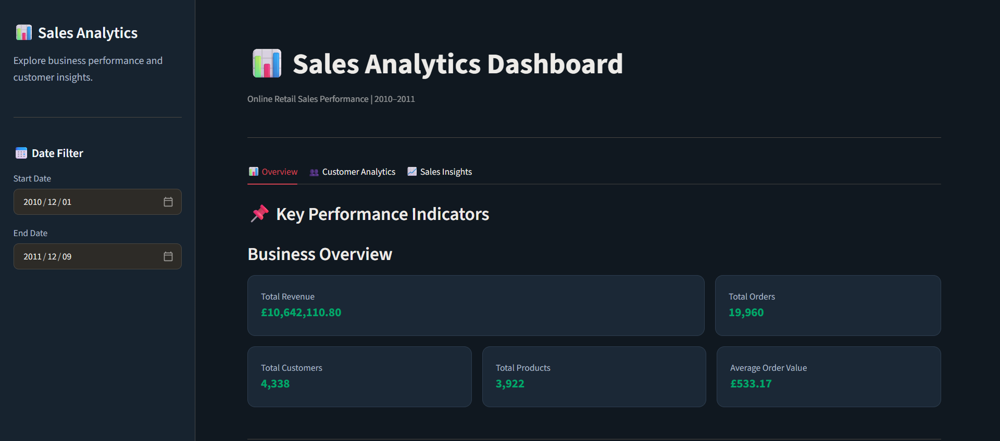
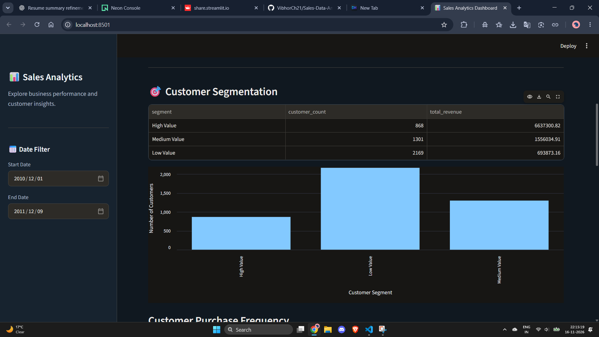
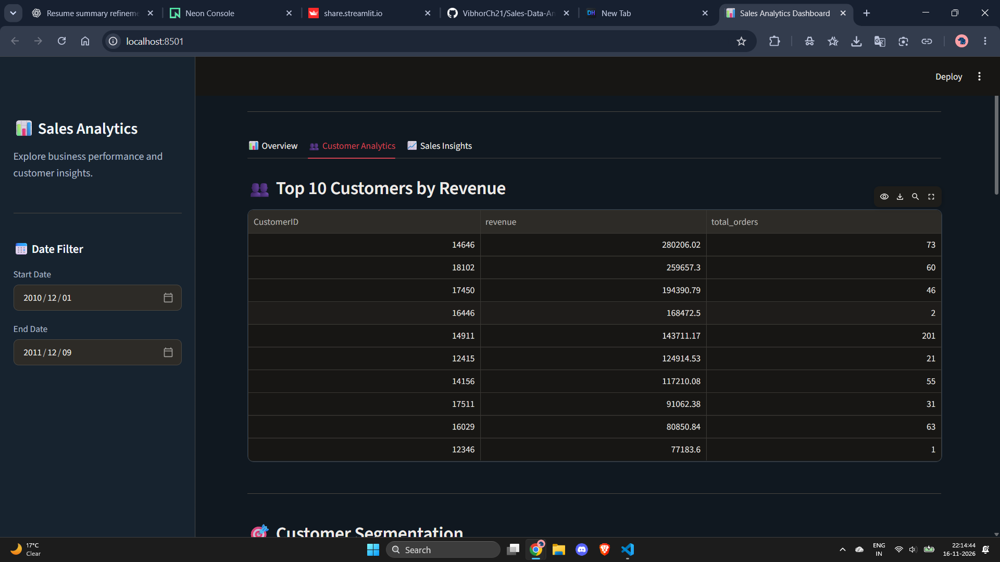
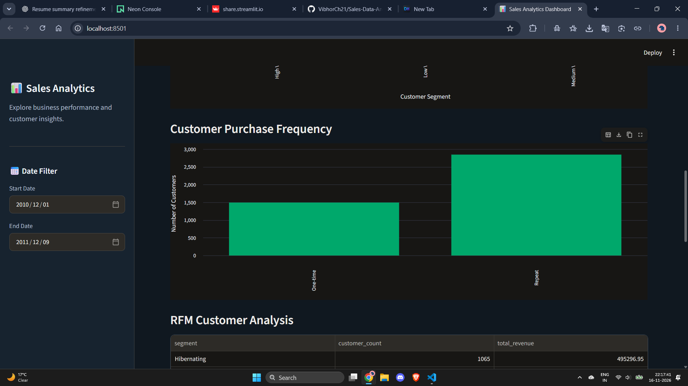
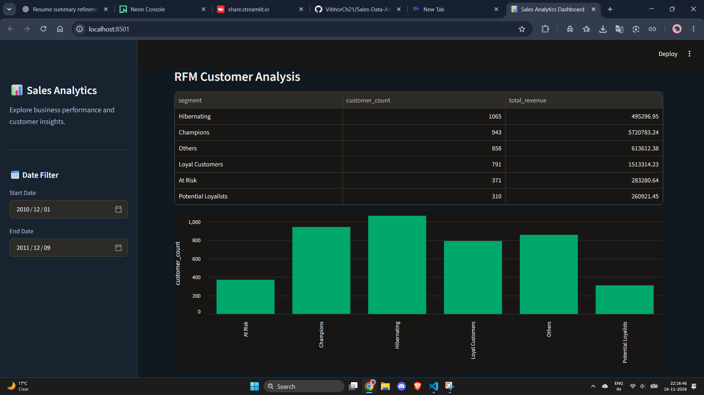
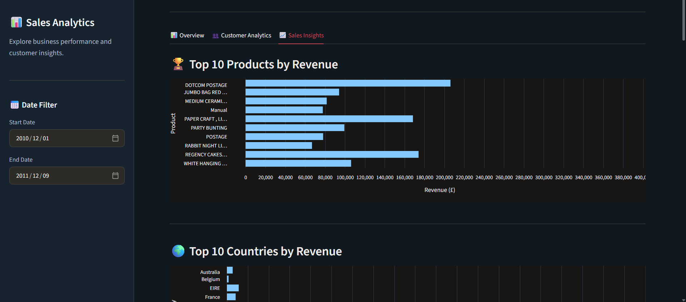
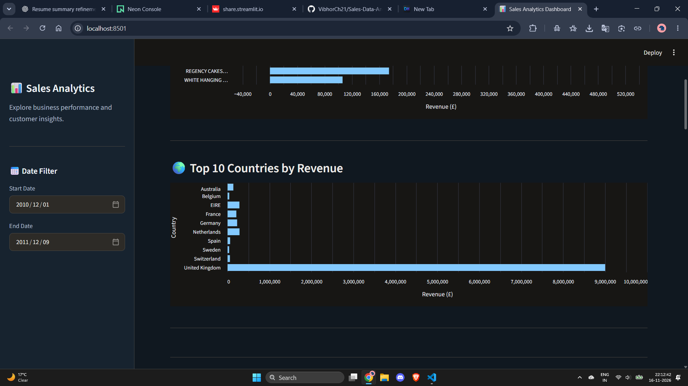

# Sales Data Analytics Dashboard

I built this project to explore how raw retail transaction data can be turned into useful business insights. The project uses Python and Pandas for data cleaning, PostgreSQL for storing the cleaned data, and Streamlit for the interactive dashboard.

**Live dashboard:** https://sales-data-analytics-hctzshtn5aqkfuxydwwdn7.streamlit.app/  
**GitHub repository:** https://github.com/VibhorCh21/Sales-Data-Analytics

> **About the data:** This project uses the UCI Online Retail dataset. It contains historical transactions from **1 December 2010 to 9 December 2011**. It is not live data from Amazon, Flipkart, Myntra, or any other marketplace. The original file has 541,909 rows; after cleaning, 524,878 completed-sale records were loaded into PostgreSQL.

## Dashboard screenshots

These screenshots show the dashboard using the full available date range in the UCI Online Retail dataset.

### Overview



### Customer Analytics

**Top 10 customers**



**Customer segmentation**



**Purchase frequency**



**RFM analysis**



### Sales Insights

**Top products by revenue**



**Country sales performance**



## What the project does

The idea was to take a retail dataset through a complete analysis workflow rather than only create a few charts. The project follows these steps:

1. Read the original Excel data using Python and Pandas.
2. Clean the data by handling duplicates, missing values, returns, cancelled invoices, and invalid prices.
3. Calculate revenue for valid sales records.
4. Store the cleaned records in a PostgreSQL database hosted on Neon.
5. Use SQL queries to analyse sales, products, countries, and customer behaviour.
6. Show the results in a Streamlit dashboard, with a date filter and CSV download option.

## Dashboard features

The dashboard is organised into three sections so the results are easier to explore.

### Overview

- Total revenue, orders, customers, and products.
- Average Order Value (AOV).
- Revenue growth compared with the previous date period.
- Monthly revenue trend.
- Quick highlights for the top-revenue product, leading country, and best sales day.

### Customer Analytics

- Top 10 customers by revenue.
- Customer groups based on their spending.
- One-time and repeat customer counts.
- RFM analysis using Recency, Frequency, and Monetary value.
- Customer counts and revenue by RFM segment.

### Sales Insights

- Top products and countries by revenue.
- Country-wise revenue contribution, orders, and customer counts.
- Sales patterns by day of the week and hour of the day.
- Order value groups based on quartiles.
- CSV export for the selected date range.

The date filter is used across the dashboard so the analysis can be explored for a particular period.

## Tools and technologies

| Area | Tools |
|---|---|
| Programming | Python |
| Data cleaning and analysis | Pandas |
| Database | PostgreSQL (Neon) |
| Database connection | SQLAlchemy, psycopg2 |
| Dashboard | Streamlit |
| Environment variables | python-dotenv |
| Testing | pytest |
| Hosting | Streamlit Community Cloud |

## Dataset

I used the **Online Retail** dataset from the UCI Machine Learning Repository.

- Dataset: [UCI Online Retail](https://archive.ics.uci.edu/dataset/352/online-retail)
- Original rows: 541,909
- Transaction period: 1 December 2010 – 9 December 2011
- Currency: GBP (£)
- Includes invoice numbers, product codes and descriptions, quantities, invoice dates, unit prices, customer IDs, and countries.

One limitation is that the dataset does not contain product costs or operating expenses. Because of that, the dashboard reports **revenue**, not profit or profit margin. Some transactions also do not have a CustomerID, so they can be included in overall sales figures but cannot be used for customer-level analysis.

## Data cleaning

The cleaning workflow is mainly in `src/data_cleaner.py`. It includes:

- Removing duplicate rows.
- Handling missing values.
- Calculating revenue as `Quantity × UnitPrice`.
- Separating returns and cancelled invoices from completed sales.
- Filtering out invalid or non-positive prices.
- Creating the completed-sales dataset used by the dashboard.

The original Excel file and processed CSV are kept in the `data/` folder locally and are excluded from Git.

## Project structure

```text
sales-data-analytics/
├── data/
│   ├── raw/                  # Original Excel dataset (not committed)
│   └── processed/            # Cleaned CSV (not committed)
├── src/
│   ├── analysis.py           # Reusable analysis functions
│   ├── data_cleaner.py       # Data cleaning functions
│   ├── data_loader.py        # Loads the source data
│   ├── database.py           # PostgreSQL connection
│   └── test_db.py            # Database connection check
├── dashboard/
│   └── app.py                # Streamlit dashboard
├── Scripts/
│   └── migrate_to_neon.py    # Loads cleaned data into Neon
├── tests/
│   └── test_data_cleaner.py  # Data cleaning tests
├── main.py                  # Runs the data processing workflow
├── requirements.txt
├── pytest.ini
├── .env                     # Local database settings (not committed)
└── README.md
```

## Run the project locally

### 1. Clone the repository

```bash
git clone https://github.com/VibhorCh21/Sales-Data-Analytics.git
cd Sales-Data-Analytics
```

### 2. Create and activate a virtual environment

On Windows PowerShell:

```powershell
python -m venv .venv
.\.venv\Scripts\Activate.ps1
```

### 3. Install the required packages

```powershell
python -m pip install -r requirements.txt
```

### 4. Add the dataset

Download `Online Retail.xlsx` from the [UCI dataset page](https://archive.ics.uci.edu/dataset/352/online-retail) and place it at:

```text
data/raw/online_retail.xlsx
```

Then run the data processing script from the project root:

```powershell
python main.py
```

This loads and cleans the source data and creates the processed CSV under `data/processed/`.

### 5. Configure the database

Create a `.env` file in the project root and add your own Neon/PostgreSQL connection details using the variable names below:

```env
NEON_DB_HOST=your_neon_host
NEON_DB_PORT=5432
NEON_DB_NAME=your_database_name
NEON_DB_USER=your_database_user
NEON_DB_PASSWORD=your_database_password
```

Keep your real credentials private. Do not commit the `.env` file or paste database passwords into public issues or messages.

### 6. Load the cleaned data into PostgreSQL

After the processed CSV has been created and the database settings are in place, run:

```powershell
python Scripts/migrate_to_neon.py
```

This script loads the cleaned records into the PostgreSQL `sales` table.

### 7. Start the dashboard

```powershell
streamlit run dashboard/app.py
```

Open the local URL shown in the terminal. Streamlit usually uses `http://localhost:8501`.

## Run the tests

With the virtual environment active, run this from the project root:

```powershell
python -m pytest -v
```

The current test suite has four data-cleaning tests. In the latest local run, all four passed:

- `test_remove_duplicates`
- `test_handle_missing_values`
- `test_calculate_revenue`
- `test_get_completed_sales`

## A few metric definitions

- **Revenue:** The sum of `Quantity × UnitPrice` for the included sales records.
- **Orders:** The number of distinct invoice numbers.
- **Average Order Value:** Revenue divided by the number of distinct orders.
- **Repeat customer:** A customer with more than one distinct invoice in the selected date range.
- **RFM:** A way of grouping customers using how recently they purchased, how often they ordered, and how much they spent.

These figures describe the selected date range. Since product costs are not included in the source data, revenue should not be read as profit.

## Current project checks

- All four existing Python data-cleaning tests passed in the latest local run.
- The Overview, Customer Analytics, and Sales Insights tabs opened successfully during local testing.
- The date filter updated dashboard results.
- The CSV export was tested with a selected January 2011 date range.

## Possible next improvements

There are still ways this project could be extended, such as adding more automated tests for SQL queries, improving data-quality checks, adding dashboard screenshots, and creating a short project walkthrough. Marketplace data could also be explored later through official APIs and the required account permissions.

## Dataset reference

Chen, D. (2015). *Online Retail* [Dataset]. UCI Machine Learning Repository. https://doi.org/10.24432/C5BW33. The dataset is provided under the Creative Commons Attribution 4.0 International (CC BY 4.0) license.
